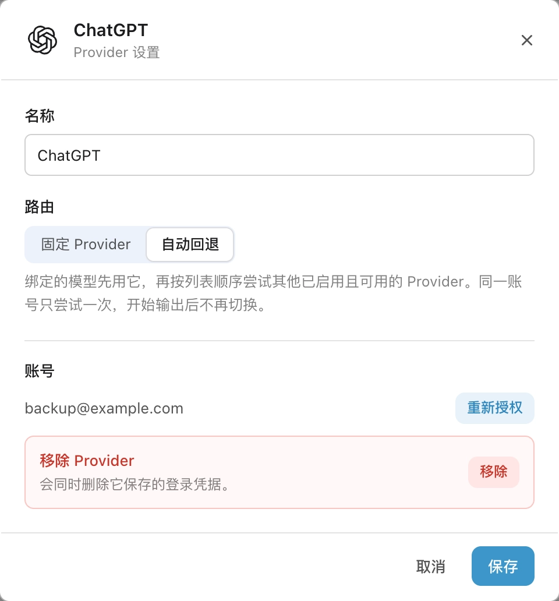

<h1 align="center">OpenAI 订阅登录</h1>

  
  
  
  

  

  <a href="README_en.md">English</a>

直接在 AstrBot 里用你的 ChatGPT 账号对话，无需另填 API Key。消耗的是订阅自带的 Codex 额度，与 OpenAI API 余额无关。使用前需要 **AstrBot 4.27.1+** 和一个支持 Codex 的 ChatGPT 账号。

## 先登录，再选模型

### 方式一：直接使用本机已登录的 Codex

如果 Codex CLI 和 AstrBot 在同一台机器上，插件会自动读取本机登录状态。到 AstrBot 模型配置里选择 **OpenAI Subscribe** 来源添加模型即可；后续在本机切换 Codex 账号，下一次请求就会切到新账号。

没识别到？请看下方[常见问题](#常见问题)，或直接改用设备码登录。

### 方式二：用设备码登录（支持多个账号）

先前往 ChatGPT **设置 → 账户安全与登录**，开启 **为 Codex 启用设备代码授权**：

查看开关位置

1. 打开插件详情页的 **Plugin Views → providers**，点 **新增账号 → 获取设备码**（名称可留空，默认使用账号邮箱）。
2. 复制授权链接在浏览器中打开，登录 ChatGPT 后输入设备码完成授权。
3. 看到「账号已保存」后，到 AstrBot 模型配置中选择 **OpenAI Subscribe** 添加模型即可。

每次新增都会作为独立账号保存，不会覆盖原有登录。**请勿将设备码发给他人，仅在 OpenAI 官方授权页中输入。**

## 管理账号与查看额度

插件会自动创建固定 ID 为 `OpenAI Subscribe` 的来源，添加模型时直接选它即可（该来源不会出现在「新增 Provider」列表里，也不支持重命名）。

所有账号都在 **Plugin Views → providers** 页面管理：

- **查看额度**：点击任意账号行即可展开额度，支持同时展开多个，页面打开时每 30 秒自动刷新（未返回额度窗口不代表无限额）。
- **编辑与停用**：点右侧齿轮可改名、切换路由，或对设备码账号重新授权、移除；最右侧开关控制是否接收新请求，关闭后不会清除登录，也不会打断正在回复的对话。
- **默认账号与模型绑定**：有多个账号时，可在齿轮菜单中**设为默认账号**（立即生效）；也可以在 AstrBot 的 **OpenAI Subscribe → 已配置模型 → 编辑 → 模型账号** 中将单个模型绑定给指定账号，或保持「跟随默认账号」（新模型默认跟随，已有模型保留原绑定）。

*截图中的账号和额度仅为示例。页面跟随 AstrBot 语言设置，支持中文、英语、俄语和日语。*

移除账号前需先更换默认账号并解除模型绑定；本地 Codex 账号只能在主机本地管理，不能在页面删除。

### 账号不可用时自动切换

在账号齿轮菜单中将路由模式改为 **自动回退** 并保存：

| 模式 | 说明 |
| --- | --- |
| 固定账号（默认） | 只使用绑定的账号，不可用时直接报错。 |
| 自动回退 | 优先使用当前账号；不可用时按列表顺序尝试其他已启用的可用账号。 |

回退仅切换账号（不换模型），且只在额度用尽、登录失效或临时网络故障时触发，参数错误等问题会直接报错。一旦开始输出内容或调用工具，当前请求便不再切换；下次请求仍优先尝试原绑定账号。

查看设置弹窗

*示例中已选择「自动回退」，点击保存后生效。*

## GPT Image 生图

在插件设置开启 **启用 GPT Image 生图** 后，在 OpenAI Subscribe 对话中直接描述想画的内容（如：「画一张竖版海报，一只猫在雨中撑伞，画面上方留白」），模型会自动调用 `codex_generate_image` 出图。画面方向、比例和构图直接写在提示词里即可，尺寸默认由 Codex 自动决定，生成后原图发回。

想跳过模型对话直接生图，可以发送 `/draw <提示词>`。命令复用当前对话最近一次通过 OpenAI Subscribe 成功聊天的账号；插件重载后，需先在当前对话聊一句再用 `/draw`。

插件设置中的 **生图账号来源 ID** 默认留空（跟随聊天实际使用的账号）；若填写了指定来源 ID，则只允许该账号回复的对话触发生图。生图不会跨账号回退。

## 常用命令与思考强度

`/openai_login` 和 `/effort` 需要管理员权限。命令回复默认为中文，可在插件设置的 `chat_language` 中改为英文、俄文或日文。

| 命令 | 用途 |
| --- | --- |
| `/usage` | 查看当前模型绑定账号的额度（即使上一轮触发过回退，仍显示绑定账号本身）。 |
| `/openai_login` | 在与机器人的私聊中发起设备码登录，默认以 ChatGPT 邮箱命名。 |
| `/openai_login cancel` | 取消当前私聊中等待授权的登录。 |
| `/effort` | 查看当前会话的思考强度，并列出当前模型支持的档位。 |
| `/effort high` | 调整当前会话的思考强度，下次请求生效。 |
| `/effort default` | 恢复模型默认设置。 |

思考强度可选 `none`、`minimal`、`low`、`medium`、`high`、`xhigh`、`max`（具体以当前模型为准）。要给模型设置固定默认值，可在模型配置的 **自定义请求体参数 → Reasoning Effort** 中填写并保存；`/effort` 只影响当前会话。

查看模型默认值的设置位置

## 常见问题

**没检测到本地 Codex 登录？**
插件默认读取 `$CODEX_HOME/auth.json`，未设置时读取 `~/.codex/auth.json`。也可在插件设置的 `codex_auth_path` 填入完整路径，保存后重载插件。请确保 AstrBot 对该文件有读权限、对所在目录有写权限以便自动刷新令牌。如果此前只在浏览器或系统钥匙串中登录而没有 `auth.json`，请改用设备码登录。

**AstrBot 在 Docker 或远程服务器上？**
容器或远程主机无法直接读取本地电脑的登录。在 Docker 中复用本地凭据时，请挂载整个 Codex 凭据目录并在 `codex_auth_path` 填写容器内路径（不要只挂载单个 `auth.json`，否则原子写入刷新会失败），或者直接用设备码登录。

**需要配置代理？**
可在 **OpenAI Subscribe** 来源的 `proxy` 中填写代理，或为 AstrBot 进程／容器设置 `HTTP_PROXY` 和 `HTTPS_PROXY`（旧版单账号配置过的代理会保留并优先使用）。若报 `unsupported_country_region_territory`，说明 OpenAI 不接受当前网络出口地区或账号条件，插件无法绕过。

**从旧版升级需要手动迁移吗？**
不需要。旧版多个来源会自动合并到 **OpenAI Subscribe** 下，保留原有模型 ID、账号偏好和登录信息。

## 安全与说明

- **凭据存储与备份**：本地登录读取 Codex 的 `auth.json`；设备码凭据加密存储在 `data/cmd_config.json`，密钥位于 `data/plugin_data/astrbot_plugin_openai_oauth/credential.key`（可用 `OPENAI_OAUTH_CREDENTIAL_KEY_FILE` 指定其他路径）。迁移或恢复备份时请连同密钥保留，缺少密钥或降级至无加密旧版后需重新登录。
- **Dashboard 访问安全**：公网访问 AstrBot Dashboard 请使用 HTTPS、VPN 或 SSH 隧道。
- **使用条款与免责**：请仅使用本人账号并遵守 OpenAI 服务条款。本插件为第三方集成，通过 Codex 客户端标识访问 ChatGPT 后端接口，不在公开 API 稳定性保障范围内；上游接口或账号策略变更可能导致功能中断或失效。

## 开发与许可证

测试与发布流程见[开发说明](https://github.com/wcqqq1214/astrbot_plugin_openai_oauth/blob/main/docs/development.md)，路由规则与 WebUI 接口见[接口说明](https://github.com/wcqqq1214/astrbot_plugin_openai_oauth/blob/main/docs/provider-routing-api.md)。

本项目采用 [AGPL-3.0](LICENSE) 许可证。
