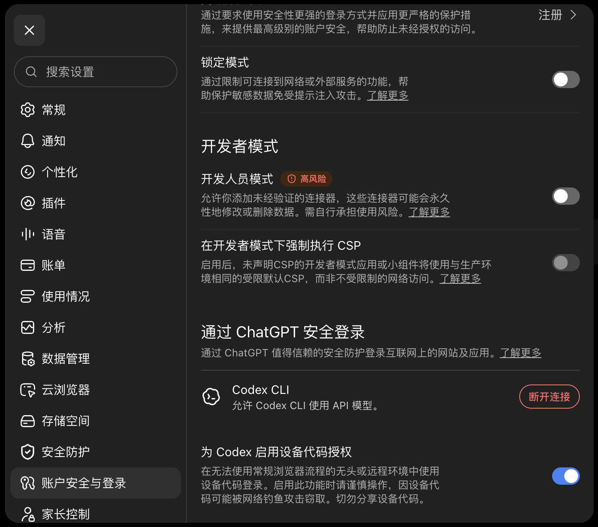
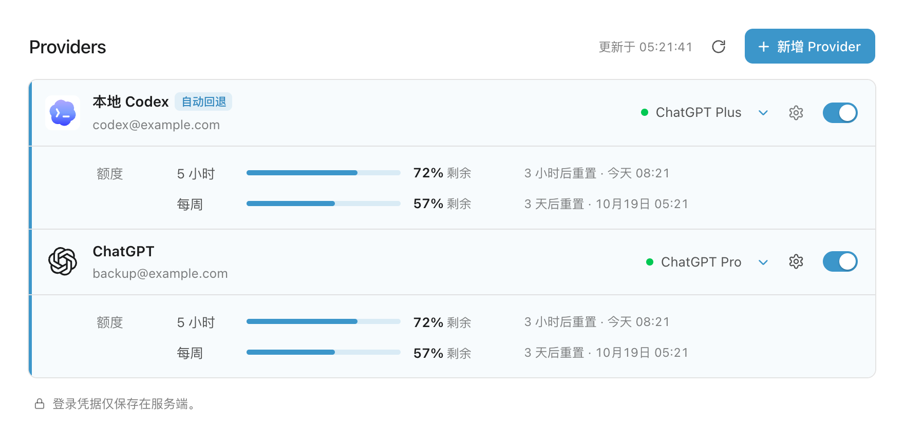
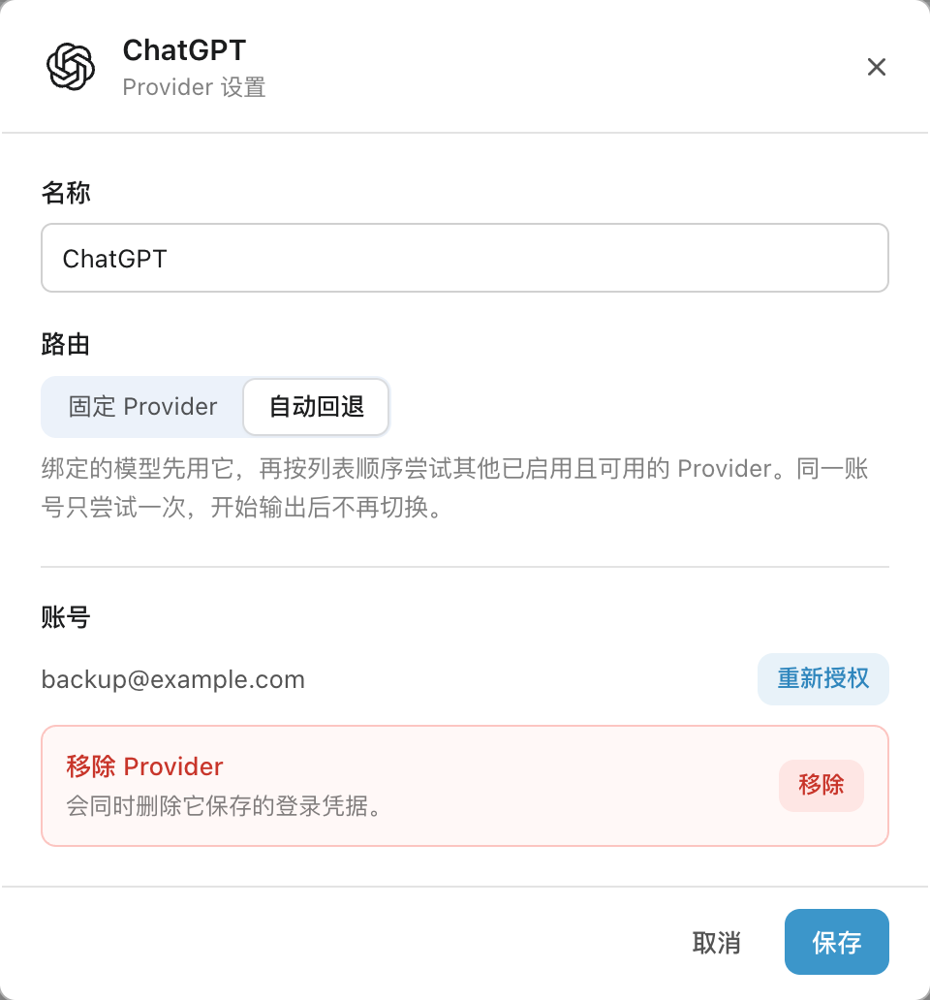
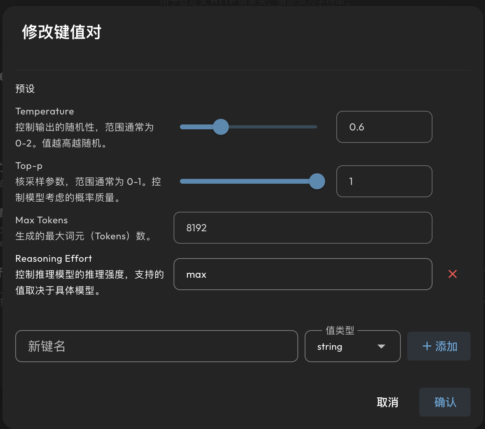

<h1 align="center">OpenAI 订阅登录</h1>

  
  
  
  

  

  <a href="README_en.md">English</a>

用你的 ChatGPT 账号在 AstrBot 里聊天，无需另填 API Key。用的是账号的 Codex 额度，
不是 OpenAI API 余额。需要 **AstrBot 4.27.1+** 和一个能使用 Codex 的 ChatGPT 账号。

## 先登录，再选模型

### 已经在本机登录 Codex

如果 Codex 和 AstrBot 在同一台机器上，插件会自动跟随 Codex 的登录。
在 AstrBot 模型配置中选择 **OpenAI Subscribe**，添加模型即可。以后在 Codex 切换账号，
下一次请求就会跟随。

没识别到登录？请看下方“常见问题”，或直接用设备码登录。

### 用设备码登录，也可以添加更多账号

先到 ChatGPT 的 **设置 → 账户安全与登录**，开启 **为 Codex 启用设备代码授权**。

查看开关位置

1. 打开插件详情页的 **Plugin Views → providers**，点 **新增 Provider → 获取设备码**。名称可不填。
2. 复制授权链接，在浏览器中打开，登录 ChatGPT 并输入设备码。
3. 看到“Provider 已保存”后，在 AstrBot 模型配置中选择新增的来源，再添加模型。

每次新增都是独立账号，不会覆盖已有登录。设备码过期可以重新获取；不想继续时点取消。
**设备码不要发给别人，只在 OpenAI 的授权页面输入。**

## 查看额度、管理账号

仍在 **Plugin Views → providers** 页面操作：

- **点账号行**查看额度，可以同时展开多个账号。页面打开时每 30 秒刷新，缺少额度数据不代表无限额。
- **点齿轮**修改名称和路由，改好后点保存。设备码登录的账号也可在这里重新授权或移除。
- **右侧开关**决定是否继续使用这个账号。关闭不会删除登录，也不会中断正在进行的请求。

*截图中的账号和额度均为示例。页面支持中文、英语、俄语和日语，跟随 AstrBot 的语言设置。*

移除账号前，先在 AstrBot 中移除绑定它的模型。本地 Codex 账号在主机上管理，不能在这里删除。
要切换聊天模型，请到 AstrBot 的模型设置中操作；点开账号只是在查看它。

### 一个账号用不了时，自动试下一个

点账号旁的齿轮，选择路由模式并保存：

| 模式 | 怎么用 |
| --- | --- |
| 固定 Provider（默认） | 只用这个账号，不可用时就报错。 |
| 自动回退 | 优先用这个账号，失败时按列表顺序尝试其他已启用、可用的账号。 |

自动回退只换账号，不换模型。额度用完、登录失效或临时网络故障时可以尝试其他账号；
参数填错等问题仍会直接报错。开始输出内容或调用工具后，不再切换重来。
下次请求仍优先尝试原来的账号，所有账号都不可用时会报错。

查看设置弹窗

*示例中已选“自动回退”，点击保存后才生效。*

## 常用命令和思考强度

`/openai_login` 和 `/effort` 需要管理员权限。

| 命令 | 用途 |
| --- | --- |
| `/usage` | 查看当前模型绑定账号的额度，不一定是上次回退后实际使用的账号。 |
| `/openai_login` | 私聊机器人，用设备码添加账号。 |
| `/effort` | 查看当前会话的思考强度。 |
| `/effort high` | 调整当前会话的思考强度，下次请求生效。 |
| `/effort default` | 恢复模型默认设置。 |

思考强度可以不设。可选值为 `low`、`medium`、`high`、`xhigh`、`max`。
要给模型设置默认值，在模型配置的 **自定义请求体参数 → Reasoning Effort** 中填写并保存。
会话命令只影响当前会话，不会修改其他会话或模型默认值。

查看模型默认值的设置位置

## 常见问题

**没读到本地 Codex 登录？** 默认读取 `$CODEX_HOME/auth.json`，未设置时读 `~/.codex/auth.json`。
可以在插件设置的 `codex_auth_path` 填完整路径，保存后重载插件。AstrBot 需要读取文件和写入所在目录的权限，
以便自动更新登录。只在浏览器或系统钥匙串中登录的情况，请改用设备码。

**AstrBot 在 Docker 或服务器上？** 它不能直接读取你电脑的登录。
Docker 需要挂载整个 Codex 凭据目录，并填写容器内的路径，不要只挂载单个文件；也可以用设备码登录。

**需要代理？** 在对应模型来源的 `proxy` 中填写，或给 AstrBot 进程／容器设置
`HTTP_PROXY` 和 `HTTPS_PROXY`。来源中填写的代理优先。
如果报 `unsupported_country_region_territory`，说明 OpenAI 不接受当前网络出口或账号条件，插件无法绕过。

**从旧版升级？** 插件会自动整理旧账号配置，保留原有模型绑定，必要时将本地登录和设备登录拆成两项，无需手动迁移。

请保管好登录文件及备份：本地登录使用 Codex 的 `auth.json`，设备码登录信息以明文保存在
AstrBot 的 `data/cmd_config.json`。公网访问 Dashboard 请使用 HTTPS、VPN 或 SSH 隧道。
请使用自己的账号，并遵守 OpenAI 的服务条款。

## 开发与许可证

开发、测试和发布方式见[开发说明](docs/development.md)，详细路由规则见[接口说明](docs/provider-routing-api.md)。
本项目采用 [AGPL-3.0](LICENSE) 许可证。
