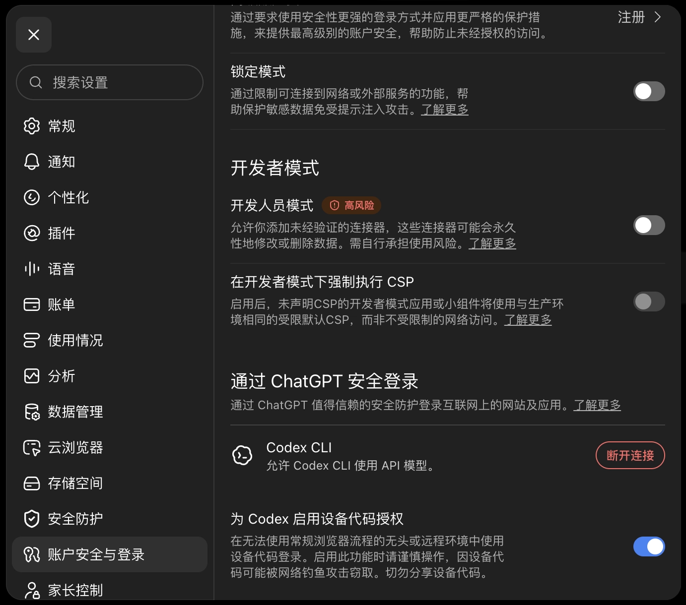
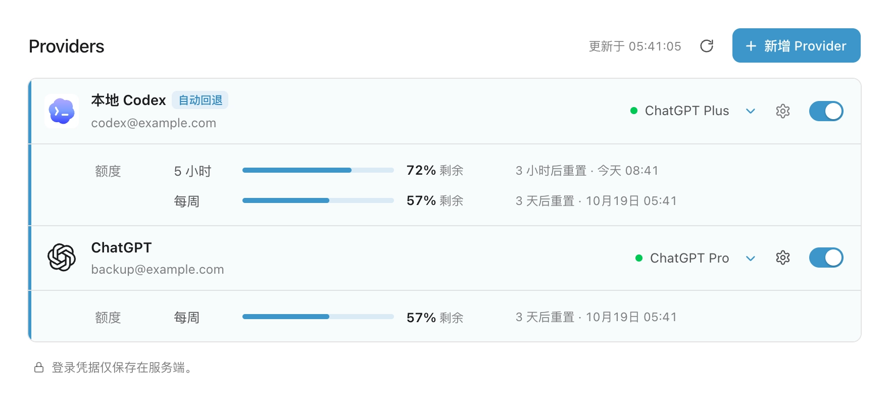
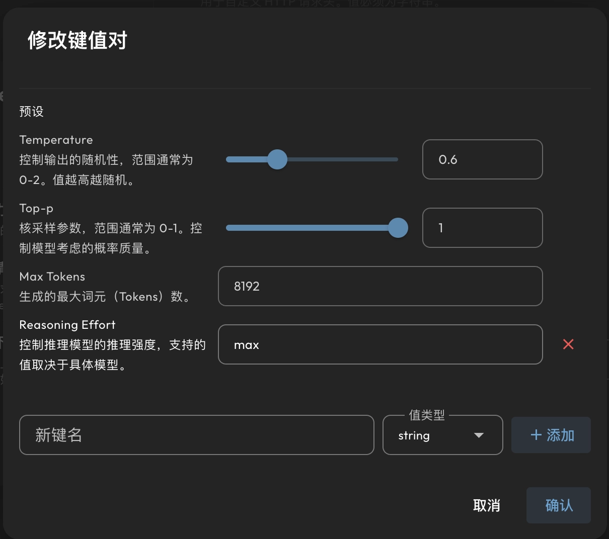

  

<h1 align="center">OpenAI 订阅登录</h1>

  直接在 AstrBot 中使用你的 ChatGPT 账号对话、生图与联网搜索，无需另填 API Key。

  
  
  
  
  

  

  <strong>简体中文</strong> · <a href="README_en.md">English</a>

  <a href="#先登录再选模型">快速开始</a> ·
  <a href="#管理账号与查看额度">账号与额度</a> ·
  <a href="#gpt-image-生图与图片输入">生图与识图</a> ·
  <a href="#原生网络搜索">原生网络搜索</a> ·
  <a href="#常用命令与思考强度">命令与思考强度</a> ·
  <a href="#插件设置">插件设置</a> ·
  <a href="#常见问题">常见问题</a>

---

本插件将 ChatGPT 订阅自带的 Codex 额度接入 AstrBot，消耗的是订阅额度，与 OpenAI API 余额无关。使用前需要 **AstrBot 4.27.1+** 和一个支持 Codex 的 ChatGPT 账号。

## 先登录，再选模型

### 方式一：直接使用本机已登录的 Codex

如果 Codex CLI 和 AstrBot 运行在同一台机器上，插件会自动读取本机登录状态。到 AstrBot 模型配置中选择 **OpenAI Subscribe** 来源添加模型即可；后续在本机切换 Codex 账号，下一次请求会自动切到新账号。

> 没识别到本机登录？请参考下方[常见问题](#常见问题)，或直接改用设备码登录。

### 方式二：用设备码登录（支持多个账号）

1. 前往 ChatGPT **设置 → 账户安全与登录**，开启 **为 Codex 启用设备代码授权**。
2. 打开插件详情页的 **Plugin Views → providers**，点击 **新增账号 → 获取设备码**（名称留空时默认使用账号邮箱）。
3. 复制授权链接在浏览器中打开，登录 ChatGPT 后输入设备码完成授权。
4. 看到「账号已保存」后，到 AstrBot 模型配置中选择 **OpenAI Subscribe** 添加模型即可。

查看 ChatGPT 设备代码授权开关位置

  

> [!IMPORTANT]
> 每次新增都会作为独立账号保存，不会覆盖原有登录。**请勿将设备码发给他人，仅在 OpenAI 官方授权页中输入。**

## 管理账号与查看额度

插件会自动创建固定 ID 为 `OpenAI Subscribe` 的来源，添加模型时直接选择它即可（该来源不会出现在「新增 Provider」列表里，也不支持重命名）。

所有账号都在 **Plugin Views → providers** 页面集中管理：

- **查看额度**：点击任意账号行即可展开额度窗口，支持同时展开多个；页面打开时每 30 秒自动刷新，对话响应返回的最新额度窗口也会同步展示（未返回额度信息不代表无限额度）。
- **编辑与停用**：点击右侧齿轮可改名、切换路由，或对设备码账号重新授权、移除；最右侧开关控制是否接收新请求，关闭后不会退出登录，也不会打断正在进行的回复。
- **默认账号与模型绑定**：列表会为当前默认账号显示徽标。配置多个账号时，可在齿轮菜单中**设为默认账号**（立即生效）；也可在 AstrBot 的 **OpenAI Subscribe → 已配置模型 → 编辑 → 模型账号** 中将单个模型绑定到指定账号，或保持「跟随默认账号」（新模型默认跟随，已有模型保留原绑定）。

  
   
  截图中的账号和额度仅为示例。页面跟随 AstrBot 语言与主题配色，支持中文、英语、俄语和日语。

移除账号前需先更换默认账号并解除模型绑定；本地 Codex 账号只能在主机本地管理，不能在页面中删除。

### 账号不可用时自动切换

在账号齿轮菜单中将路由模式改为 **自动回退** 并保存：

| 路由模式 | 行为说明 |
| --- | --- |
| **固定账号**（默认） | 仅使用绑定的账号，不可用时直接报错。 |
| **自动回退** | 优先使用当前绑定账号；不可用时按列表顺序尝试其他已启用的可用账号。 |

- **触发条件**：仅在额度用尽、登录失效或临时网络故障时切换账号（不更换模型）；参数错误等问题会直接报错。
- **输出保护**：一旦开始输出内容或调用工具，当轮请求不会再中途切换；下次请求仍优先尝试原绑定账号。

查看账号设置弹窗

  
   
  示例中已选择「自动回退」，点击保存后生效。

## GPT Image 生图与图片输入

在插件详情页 **Plugin Views → providers** 的「原生网络搜索」旁，或在 AstrBot 的插件设置中，打开 **GPT Image 生图**。两个入口共用 `image_enabled`，默认关闭。开启后可使用当前聊天账号的订阅额度生成和编辑图片。

- **对话自动生图**：在 OpenAI Subscribe 对话中直接描述画面（如：「画一张竖版海报，一只猫在雨中撑伞，画面上方留白」），模型会自动调用 `codex_generate_image` 出图。画面方向、比例和构图直接写在提示词里即可，尺寸由 Codex 自动决定并原样返回 PNG。
- **编辑参考图**：在同一条消息中附上一张图并写「保留人物和构图，把背景换成夜景」。模型会调用 `codex_edit_image`，用本轮实际聊天账号编辑原图并发回 PNG。只问「这张图里有什么」时，模型会直接看图回答。在 ChatUI 中，即使中间聊过几句，也可以说「保留构图，把背景换成白天」，继续编辑当前会话中机器人最近发的图片。本条消息的附件优先。如果最近一次发了多张图，或原附件已失效，请附上要改的那张图。
- **命令直接生图**：发送 `/draw <提示词>` 可跳过模型追问直接出图。命令复用当前对话最近一次通过 OpenAI Subscribe 成功聊天的账号；插件重载后，需先在当前对话聊一句再用 `/draw`。
- **指定生图账号**：插件设置中的 **生图账号来源 ID**（`image_account`）默认留空（跟随聊天实际使用的账号）；如果指定了来源 ID，则只有该账号回复过的对话才能生图。生图不会跨账号回退。
- **输入图片自动缩放**：向模型发送超大图片时，插件会在发往 Codex 前将长边自动限制为 2048 像素（请求原始细节时为 6000 像素），同时保持原始附件与 AstrBot 共享历史记录不变。

## 原生网络搜索

可在插件详情页 **Plugin Views → providers → 原生网络搜索** 中开启（默认关闭）。开启后直接使用 Codex 自带的联网搜索，无需额外配置 API Key 或第三方搜索服务，也不会影响 AstrBot 原有的函数工具。

- **ChatUI 展示**：展开运行记录里的搜索卡片可查看查询词；正文按 OpenAI 返回的引用位置显示可点击的来源卡片，底部「来源」汇总本次引用的网页。
- **Bot 平台展示**：回复在对应句末标注 `〔编号〕`，同一网址在一轮回复中共用编号。支持正文链接的平台可直接点击编号，支持来源按钮的平台在正文后显示按钮，其余平台在底部列出标题和完整网址。

## 常用命令与思考强度

`/openai_login` 和 `/effort` 需要管理员权限。聊天回复默认跟随 AstrBot 系统语言（旧版 AstrBot 回退为中文），也可在插件设置的 **聊天回复语言**（`chat_language`）中手动指定中文、英文、俄文或日文。

| 命令 | 用途 |
| --- | --- |
| `/usage` | 查看当前模型绑定账号的额度（即使上一轮触发过回退，仍显示原本绑定的账号）。 |
| `/openai_login` | 在与机器人的私聊中发起设备码登录，默认以 ChatGPT 邮箱命名。 |
| `/openai_login cancel` | 取消当前私聊中等待授权的登录。 |
| `/effort` | 查看当前会话的思考强度，并列出当前模型支持的档位。 |
| `/effort high` | 调整当前会话的思考强度，下次请求生效。 |
| `/effort default` | 清除当前会话覆盖，恢复模型默认设置。 |

思考强度可选 `none`、`minimal`、`low`、`medium`、`high`、`xhigh`、`max`（具体以当前模型支持为准）。`/effort` 仅影响当前会话；若要给模型设置固定默认值，可在模型配置的 **自定义请求体参数 → Reasoning Effort** 中填写并保存。

查看模型默认思考强度的设置位置

  

## 插件设置

可在 AstrBot 插件管理页打开本插件的设置面板调整以下配置项：

| 配置项 | 默认值 | 说明 |
| --- | --- | --- |
| `codex_auth_path` | 留空 | 自定义本地 Codex `auth.json` 路径；留空时依次读取 `$CODEX_HOME/auth.json`、`~/.codex/auth.json`。保存后重载插件生效。 |
| `chat_language` | `auto`（跟随系统语言） | `/usage`、`/effort`、`/openai_login`、`/draw` 及报错提示的语言，可选跟随系统、简体中文、English、Русский、日本語。 |
| `image_enabled` | `false` | 是否启用 GPT Image 对话生图、参考图编辑与 `/draw` 命令。 |
| `image_account` | 留空 | 限定允许生成和编辑图片的账号来源 ID。留空时跟随当前对话实际使用的账号。 |

## 常见问题

### 没检测到本地 Codex 登录？

插件默认读取 `$CODEX_HOME/auth.json`，未设置时读取 `~/.codex/auth.json`。也可在插件设置的 `codex_auth_path` 填入完整路径，保存后重载插件。请确保 AstrBot 对该文件有读权限、对所在目录有写权限，以便自动刷新登录凭据。如果此前只在浏览器或系统钥匙串中登录而没有 `auth.json`，请改用设备码登录。

### AstrBot 在 Docker 或远程服务器上？

推荐直接使用插件的设备码登录，服务器无需安装 Node.js、npm 或 Codex CLI。插件启动时会在后台查询 npm 上的 Codex CLI 稳定版本，之后每 6 小时检查一次；请求模型目录和对话时，默认取内置版本、本地 Codex 缓存版本与 npm 稳定版本三者中的最高版本（npm 暂时不可达时继续使用已有版本）。

如果服务器已经运行 Codex CLI，也可以复用它的登录。Docker 部署请挂载整个 Codex 凭据目录，并在 `codex_auth_path` 填写容器内的 `auth.json` 路径；刷新凭据时会原子替换该文件，因此需要所在目录的写权限。

### 需要配置代理？

可在 **OpenAI Subscribe** 来源的 `proxy` 中填写代理，或为 AstrBot 进程／容器设置 `HTTP_PROXY` 和 `HTTPS_PROXY`（旧版单账号配置过的代理会保留并优先使用）。若报 `unsupported_country_region_territory`，说明当前出口 IP 地区或账号不符合 OpenAI 要求，插件无法绕过。

### 从旧版升级需要手动迁移吗？

不需要。旧版多个来源会自动合并到 **OpenAI Subscribe** 下，保留原有模型 ID、账号偏好和登录信息。

## 安全与说明

- **凭据存储与备份**：本地登录读取 Codex 的 `auth.json`；设备码凭据加密存储在 `data/cmd_config.json`，密钥位于 `data/plugin_data/astrbot_plugin_openai_oauth/credential.key`（可用 `OPENAI_OAUTH_CREDENTIAL_KEY_FILE` 指定其他路径）。迁移或恢复备份时请连同密钥一并保留，缺少密钥或降级到无加密旧版需重新登录。
- **Dashboard 访问安全**：公网访问 AstrBot Dashboard 请使用 HTTPS、VPN 或 SSH 隧道。
- **使用条款与免责**：请仅使用本人账号并遵守 OpenAI 服务条款。本插件为第三方实现，通过 Codex 客户端接口访问 ChatGPT 服务，并非 OpenAI 官方公开 API；上游接口或账号策略变化随时可能导致功能中断或受限。

## 开发与许可证

测试与发布流程见[开发说明](https://github.com/wcqqq1214/astrbot_plugin_openai_oauth/blob/main/docs/development.md)，路由规则与 WebUI 接口见[接口说明](https://github.com/wcqqq1214/astrbot_plugin_openai_oauth/blob/main/docs/provider-routing-api.md)。

本项目采用 [AGPL-3.0](LICENSE) 许可证。
