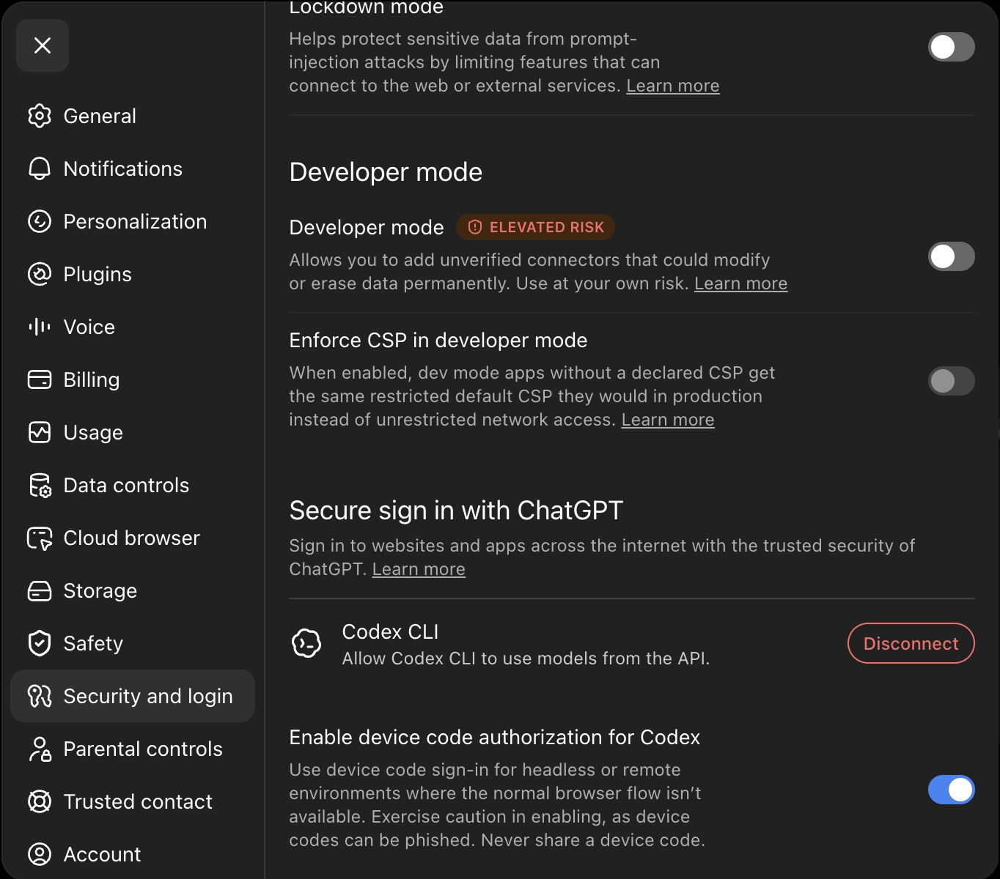
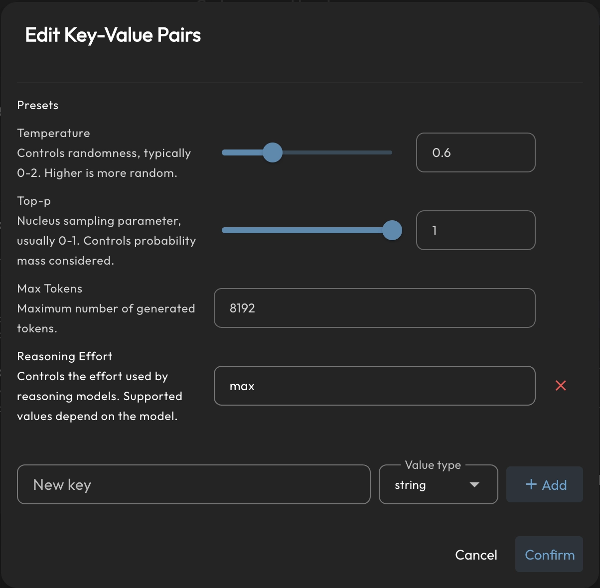

  

<h1 align="center">OpenAI Subscription Sign-in</h1>

  Chat, generate images, and search the web in AstrBot with your ChatGPT account—no separate API key needed.

  
  
  
  
  

  

  <a href="README.md">简体中文</a> · <strong>English</strong>

  <a href="#sign-in-then-choose-a-model">Quick Start</a> ·
  <a href="#managing-accounts-and-checking-allowances">Accounts & Allowances</a> ·
  <a href="#gpt-image-generation-and-image-inputs">Images</a> ·
  <a href="#native-web-search">Native Web Search</a> ·
  <a href="#commands-and-reasoning-effort">Commands & Effort</a> ·
  <a href="#plugin-settings">Plugin Settings</a> ·
  <a href="#common-questions">FAQ</a>

---

Usage draws from your ChatGPT subscription's included Codex allowance rather than an OpenAI API balance. Requires **AstrBot 4.27.1+** and a ChatGPT account with Codex access.

## Sign in, then choose a model

### Option 1: Use an existing local Codex login

If Codex CLI and AstrBot run on the same machine, the plugin picks up your local Codex login automatically. Select **OpenAI Subscribe** in AstrBot's model settings and add a model; whenever you switch accounts in Codex locally, the next request follows along.

> Not detected? See [Common questions](#common-questions) below or sign in with a device code instead.

### Option 2: Sign in with a device code (or add more accounts)

1. Open ChatGPT **Settings → Security and login** and turn on **Enable device code authorization for Codex**.
2. On the plugin's detail page, open **Plugin Views → providers** and click **Add account → Get device code** (leave the name blank to use the account's ChatGPT email).
3. Copy the verification link into a browser, sign in to ChatGPT, and enter the device code.
4. Once you see **Account saved**, add models under **OpenAI Subscribe** in AstrBot's model settings.

Show where to find the ChatGPT device-code switch

  

> [!IMPORTANT]
> Each account is stored independently without overwriting existing logins. **Never share your device code; enter it only on OpenAI's official verification page.**

## Managing accounts and checking allowances

The plugin creates a single AstrBot provider source with the fixed ID `OpenAI Subscribe`. Simply choose it when adding models (it cannot be renamed and won't appear under **Add Provider**).

Manage all accounts in **Plugin Views → providers**:

- **Check allowances**: Click any account row to expand its usage windows (multiple rows can stay open, refreshing every 30 seconds while visible, and chat responses also update reported quota windows passively). Missing windows do not mean unlimited usage.
- **Edit or disable**: Click the gear icon to rename an account, change its routing mode, or reauthorize/remove device-code accounts. The right-side toggle controls whether new requests use that account; turning it off preserves credentials and lets active requests finish.
- **Default account & model bindings**: The current default account is marked with a badge in the list. With multiple accounts configured, use an account's gear menu to **Set as default account** (takes effect immediately), or open **OpenAI Subscribe → configured model → Edit → Model account** in AstrBot to pin a model to a specific account or keep **Follow default** (new models follow the default; existing ones retain their bindings).

  
   
  Account names and allowance values shown above are examples. The page follows AstrBot's language and theme colors (Chinese, English, Russian, and Japanese).

Before removing an account, switch the default account elsewhere and clear any model bindings pointing to it. Local Codex is managed on the host and cannot be deleted here.

### Automatic fallback across accounts

Open an account's gear menu, switch routing to **Automatic fallback**, and click **Save**:

| Routing Mode | Behavior |
| --- | --- |
| **Fixed account** (default) | Uses only the bound account and returns an error if unavailable. |
| **Automatic fallback** | Tries the bound account first, then falls back through other enabled, available accounts in list order. |

- **When it triggers**: Switches accounts only (never the model) on exhausted allowances, expired logins, or transient network failures; invalid request parameters fail immediately.
- **Stream safety**: Once a reply starts streaming text or tool calls, that turn won't switch and restart, and the next request returns to trying the preferred account first.

Show the account settings dialog

  
   
  Automatic fallback is selected in this example; click Save to apply it.

## GPT Image generation and image inputs

Turn on **GPT Image generation** next to **Native web search** under **Plugin Views → providers**, or in AstrBot's plugin settings. Both controls use the same `image_enabled` setting, which defaults to off. Generation and editing use the current chat account’s subscription allowance.

- **In-chat generation**: Describe an image in an OpenAI Subscribe chat (e.g., *"Draw a portrait poster of a cat holding an umbrella in the rain, with space at the top"*). The model calls `codex_generate_image` to create and send the PNG. Specify orientation, aspect ratio, and composition in your prompt; Codex chooses the pixel dimensions automatically.
- **Edit an attached image**. Attach one image and write “Keep the person and composition, and change the background to a night scene” in the same message. The model calls `codex_edit_image` to edit the original with the account serving that turn and sends back a PNG. Asking “What’s in this image?” gets a text answer. If the attachment cannot be read, send it again with the edit instructions.
- **Direct `/draw` command**: Send `/draw <prompt>` to skip follow-up questions from the model. It reuses whichever account handled the most recent successful OpenAI Subscribe chat in that conversation (after a plugin reload, send one normal chat message before using `/draw` again).
- **Account restriction**: Leave `image_account` blank to follow whichever account answered the chat, or set a source ID to allow drawing only on turns handled by that source. Image generation never falls back across accounts.
- **Automatic input image resizing**: Oversized image attachments sent to the model are automatically resized for Codex (longest edge capped at 2048 px by default, or 6000 px when original detail is requested) while leaving original attachments and AstrBot's shared history untouched.

## Native web search

Turn on **Native web search** under **Plugin Views → providers** (off by default). When enabled, requests use Codex's built-in `web_search` tool without extra API keys or third-party search services, alongside your existing AstrBot function tools.

- **In ChatUI**: Expand a search card in the run history to see its queries. Click an inline source card at the position cited by OpenAI, or open **Sources** below the reply to see all cited pages.
- **In bot replies**: Cited sentences are marked with a bracketed number (reused for the same URL throughout the turn). Depending on the platform adapter, readers can click the number inline, use source buttons below the reply, or read the titles and full URLs listed at the end.

## Commands and reasoning effort

`/openai_login` and `/effort` require administrator permissions. Chat replies follow AstrBot's system language by default (falling back to Chinese on older AstrBot versions), or can be set manually via `chat_language` in plugin settings (Chinese, English, Russian, or Japanese).

| Command | What it does |
| --- | --- |
| `/usage` | Shows the allowance for the account bound to your current model (even if the last reply fell back to another account). |
| `/openai_login` | Starts a device-code sign-in in a private chat with the bot, named after its ChatGPT email. |
| `/openai_login cancel` | Cancels a pending device-code sign-in in the current private chat. |
| `/effort` | Displays the current conversation's reasoning effort and the levels supported by the model. |
| `/effort high` | Overrides this conversation's reasoning effort starting on the next request. |
| `/effort default` | Clears the conversation override and restores the model default. |

Reasoning effort is optional (`none`, `minimal`, `low`, `medium`, `high`, `xhigh`, `max`, depending on the model). `/effort` affects only the current conversation; to set a persistent model default, enter a value under **Custom request body parameters → Reasoning Effort** in the model's settings and save.

Show where to set the model default

  

## Plugin settings

Configure the following options in the plugin's settings dialog inside AstrBot:

| Setting | Default | Description |
| --- | --- | --- |
| `codex_auth_path` | *(empty)* | Optional full path to a local Codex `auth.json` file. When blank, checks `$CODEX_HOME/auth.json` and `~/.codex/auth.json`. Reload the plugin after saving. |
| `chat_language` | `auto` (follow system) | Language for `/usage`, `/effort`, `/openai_login`, `/draw`, and provider errors (`auto`, Simplified Chinese, English, Russian, or Japanese). |
| `image_enabled` | `false` | Enables in-chat GPT Image generation, reference image editing, and the `/draw` command. |
| `image_account` | *(empty)* | Restricts generation and editing to turns served by the specified account source ID. Blank follows the active chat account. |

## Common questions

### Local Codex login not detected?

The plugin reads `$CODEX_HOME/auth.json`, or `~/.codex/auth.json` if unset. Set a full file path in `codex_auth_path` and reload the plugin to override it. AstrBot needs read access to the file and write access to its parent directory for automatic token refreshes. Browser-only or keychain-only logins without an `auth.json` file need device-code sign-in instead.

### Running AstrBot in Docker or on a remote server?

Use the plugin's device-code login—the server does not need Node.js, npm, or the Codex CLI. At startup and every six hours, the plugin checks npm for the stable Codex CLI version in the background. By default, model discovery and chat use the highest of the built-in version, the local Codex catalog version, and the stable version retrieved from npm (if npm is unreachable, requests continue with the versions already available).

If the server already runs the Codex CLI, you can also reuse its login. For Docker, mount the entire Codex credentials directory and set `codex_auth_path` to the path of `auth.json` inside the container; the plugin needs directory write access to replace that file atomically when refreshing credentials.

### Need a proxy?

Set `proxy` on the **OpenAI Subscribe** source, or pass `HTTP_PROXY` and `HTTPS_PROXY` to the AstrBot process/container (per-account proxies migrated from older versions are preserved and take precedence). `unsupported_country_region_territory` means OpenAI is rejecting your exit IP region or account eligibility, which the plugin cannot bypass.

### Upgrading from an older version?

Migration is automatic: older separate sources consolidate under **OpenAI Subscribe** while preserving your model IDs, account preferences, and logins.

## Security and disclaimer

- **Credentials and backups**: Local sign-in uses Codex's `auth.json`. Device-code credentials are stored encrypted in `data/cmd_config.json`, using the key in `data/plugin_data/astrbot_plugin_openai_oauth/credential.key` (override with `OPENAI_OAUTH_CREDENTIAL_KEY_FILE`). Keep that key with any backup you restore; losing it or downgrading to a version without encryption requires signing in again.
- **Dashboard access**: Use HTTPS, a VPN, or an SSH tunnel whenever exposing the AstrBot Dashboard to the internet.
- **Terms and stability**: Use your own account and follow OpenAI's Terms of Service. This is an unofficial integration using Codex client identifiers to reach ChatGPT backend endpoints outside public API compatibility guarantees; upstream changes may interrupt or limit access at any time.

## Development and license

See the [development guide](https://github.com/wcqqq1214/astrbot_plugin_openai_oauth/blob/main/docs/development.md) for testing and release workflows, and the [API guide](https://github.com/wcqqq1214/astrbot_plugin_openai_oauth/blob/main/docs/provider-routing-api.md) for routing rules and WebUI endpoints.

Licensed under [AGPL-3.0](LICENSE).
