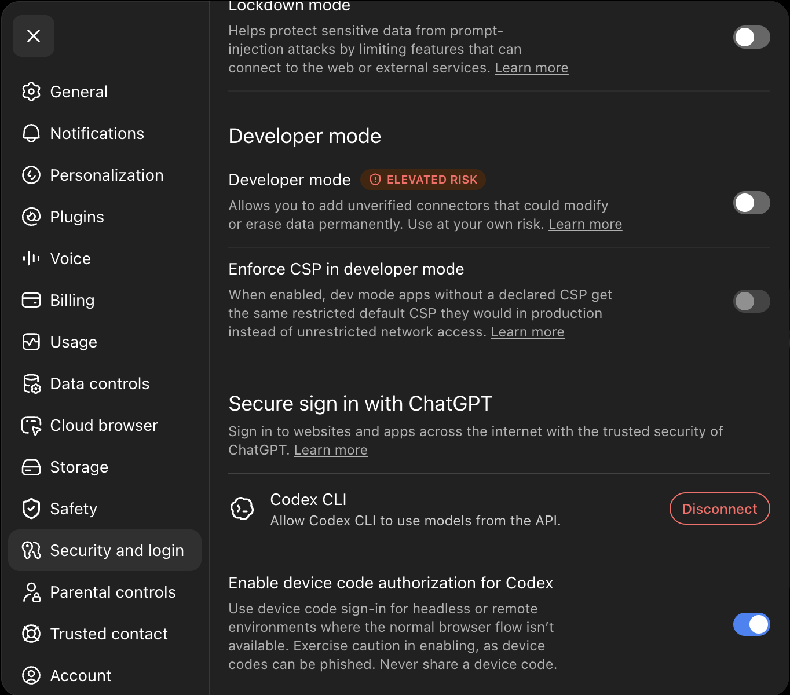
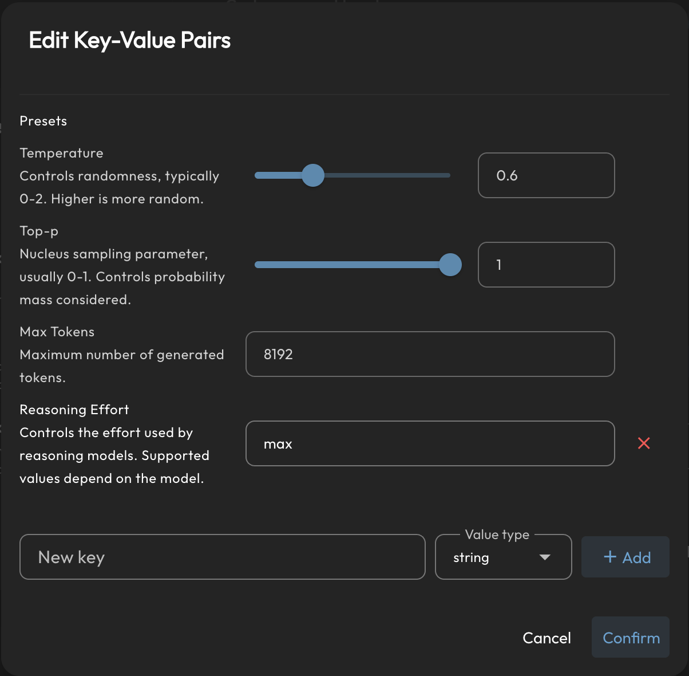

<h1 align="center">OpenAI Subscription Sign-in</h1>

<p align="center">
  <a href="https://github.com/wcqqq1214/astrbot_plugin_openai_oauth/releases/tag/v1.3.2"></a>
  <a href="https://github.com/AstrBotDevs/AstrBot"></a>
  
  <a href="LICENSE"></a>
</p>

<p align="center">
  
</p>

<p align="center">
  <a href="README.md">简体中文</a>
</p>

This plugin connects your ChatGPT account to AstrBot. After installation,
AstrBot gets an `OpenAI Subscribe` model source. Choose a model from that
source to use your ChatGPT/Codex quota—no separate OpenAI API key is needed.

In short: usage counts against the Codex quota available to your ChatGPT
account, not your prepaid OpenAI API balance.

## Before you start

- Use AstrBot `4.27.1` or later.
- You need a ChatGPT account that can use Codex.
- If your Dashboard is publicly reachable, use HTTPS, a VPN, or an SSH tunnel.
  Device-code sign-in also works over plain HTTP, but the Dashboard session can
  be intercepted, so it is not recommended.
- For backup device-code login, open ChatGPT **Settings → Security and login** and turn on
  **Enable device code authorization for Codex**.



*Figure: The switch is on ChatGPT's **Security and login** page. Its label in
the screenshot is **Enable device code authorization for Codex**.*

> Treat a device code like a password: enter it only on OpenAI's verification
> page, and never share it with anyone.

## Default: follow local Codex

The plugin uses the current Codex account on the **machine running AstrBot** by
default. Sign in to Codex there, then choose the `OpenAI Subscribe` source in
AstrBot's model configuration. No Plugin Page login is required.

- Reads `$CODEX_HOME/auth.json`, or `~/.codex/auth.json` when `CODEX_HOME` is unset.
  Set the plugin's `codex_auth_path` to override the full file path.
- Rereads credentials for each model request and quota lookup. Account switches
  apply to the next request; requests already in progress keep their starting account.
- Does not copy local credentials into AstrBot configuration. Refresh atomically
  writes rotated tokens back to the Codex file, preserving other fields. AstrBot
  needs file read access and directory write access.
- In Docker, mount the entire credentials directory and configure the path inside
  the container. A single-file mount may prevent atomic replacement. A remote
  AstrBot server cannot read credentials from your personal computer directly.
- Supports file-backed ChatGPT OAuth credentials. Keyring-only logins, API-key
  logins and browser ChatGPT sessions need the backup device-login flow instead.

Missing, unreadable or unsupported local credentials fall back to the account
saved through the Plugin Page. Exhausted quota or a failed refresh does not
automatically switch accounts: sign in to Codex again, or disable
`follow_local_codex` to use the saved plugin account exclusively. Reload the
plugin after changing settings. The Plugin Page identifies the active credential source.

## Backup: device-code login

1. Install the plugin from the AstrBot plugin marketplace. For a manual
   installation, place the project in `data/plugins/`.
2. Open this plugin's detail page and enter its **Plugin Views** (formerly Plugin Page). Click **Add backup login**, then
   **Start login**.
3. The page shows an OpenAI verification URL and a device code. Open the URL,
   sign in to ChatGPT, enter the code, and approve the request.
4. Return to AstrBot and wait for the “Backup login saved” message. Credentials are
   stored only on the AstrBot server; they are not shown in the browser or chat.
5. Local Codex still takes priority if available. To use the backup immediately,
   disable `follow_local_codex` and reload the plugin, then select a model from
   the `OpenAI Subscribe` source.

The account page shows the active source, sign-in health, saved backup status,
and the actual subscription plan. It refreshes every 30 seconds while visible.
Quota bars follow the returned window durations: a weekly-only Pro response
shows one weekly bar and its reset time. Missing data and lookup failures are
unavailable, never unlimited or a fabricated full allowance. You can select
**Cancel login** while a device code is still waiting for approval. After you
sign in, `/usage` in chat also shows your quota.

If the WebUI is unavailable, an administrator can send this in a **private
chat** with the bot:

```text
/openai_login
```

The bot replies with the verification URL and a one-time device code. Complete
the sign-in in that private chat; the flow will not start in group chats.

## Want to set the reasoning effort? (Optional)

You do not need to configure this for normal use—the model uses its default
behavior.

1. Open model configuration and edit the model that uses `OpenAI Subscribe`.
2. Find **Custom request body parameters (`custom_extra_body`)**.
3. Enter the desired value in **Reasoning Effort**, then click **Confirm** in
   the lower right corner to save.



*Figure: AstrBot's built-in **Reasoning Effort** preset. Enter `max`, then
click **Confirm**.*

This plugin supports these lowercase values:

| Common WebUI label | Value to enter |
| --- | --- |
| Light | `low` |
| Medium | `medium` |
| High | `high` |
| Extra High | `xhigh` |
| Max | `max` |

Enter the value from the right column rather than the label on the left. The
plugin converts it to the format Codex expects.

### Set reasoning effort for only the current session

Administrators can use these commands in the current private or group-chat
session:

```text
/effort
/effort low
/effort medium
/effort high
/effort xhigh
/effort max
/effort default
```

`/effort` shows the current setting. A chosen value takes effect on the next
request. `/effort default` removes the session override and restores the model
default. It does not change other sessions or the model's global configuration.

## Network, quota, and security

- With the default direct connection, the plugin talks only to OpenAI's
  `auth.openai.com` and `chatgpt.com` hosts for sign-in, token refresh, model
  discovery, quota checks, and inference.
- Configure the plugin's `proxy` only when the network cannot reach OpenAI
  directly. For an authorized outbound proxy in Docker or on a cloud server,
  set both `HTTP_PROXY` and `HTTPS_PROXY` in the **AstrBot container** and leave
  the plugin's own `proxy` empty. A non-empty plugin `proxy` takes precedence.
- Credentials are never returned to the browser or sent to chat. Local mode uses
  Codex's `auth.json`; backup device credentials are stored in plaintext in
  AstrBot's `data/cmd_config.json`. Limit read access to these files and their backups.
- One `OpenAI Subscribe` model source represents one ChatGPT account. When the
  quota is exhausted, the page shows the cooldown and reset time; the plugin
  does not rotate accounts automatically.
- If you see `unsupported_country_region_territory`, OpenAI does not accept the
  deployment egress network or account conditions. The plugin cannot bypass
  that restriction.

Use your own account and make sure your use complies with OpenAI's terms of
service.

## Development checks

Run `tests/run_tests.py` with the local AstrBot virtualenv's Python. It tests this
checkout rather than a deployed plugin copy and uses a temporary Codex directory
to avoid reading or refreshing real account credentials.

## License

AGPL-3.0.
