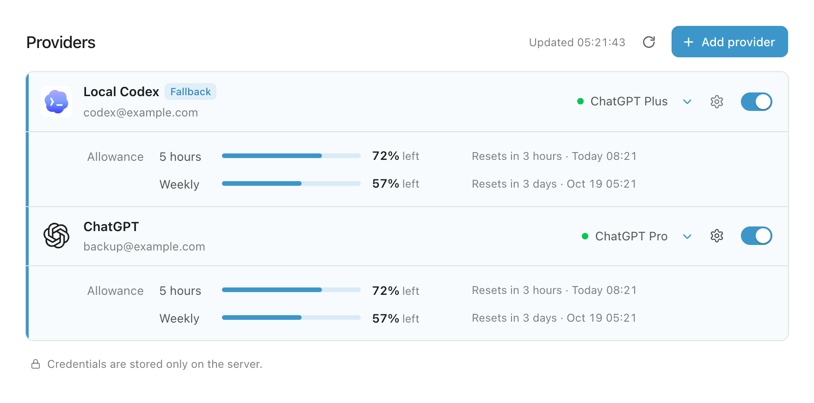
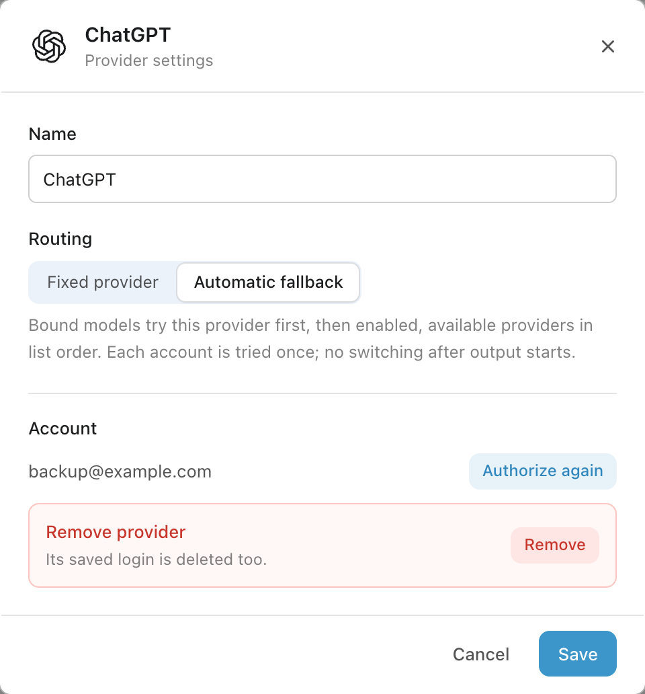

<h1 align="center">OpenAI Subscription Sign-in</h1>

  
  
  
  

  

  <a href="README.md">简体中文</a>

Use your ChatGPT account in AstrBot without a separate API key. Usage comes from
your account’s Codex allowance, not your OpenAI API balance. You’ll need **AstrBot
4.27.1+** and a ChatGPT account with access to Codex.

## Sign in, then choose a model

### Already signed in to Codex locally?

If Codex and AstrBot run on the same machine, the plugin follows the local Codex
login. Choose **OpenAI Subscribe** in AstrBot’s model settings and add a model.
Switching accounts in Codex takes effect on the next request.

If the login isn’t detected, check the tips below or use a device code instead.

### Use a device code to sign in or add more accounts

In ChatGPT, open **Settings → Security and login** and turn on
**Enable device code authorization for Codex**.

Show where to find the switch

1. Open **Plugin Views → providers** on the plugin’s detail page. Click **Add account → Get device code**. The name is optional.
2. Copy the authorization link into your browser, sign in to ChatGPT, and enter the code.
3. After **Account saved**, choose the default account under **Account selection** in the plugin page. Then add models under **OpenAI Subscribe** in AstrBot.

Each addition keeps its own login without replacing another account. You can cancel
or get a new code if it expires. **Never share the code; enter it only on OpenAI’s authorization page.**

## Check allowances and manage accounts

AstrBot shows one **OpenAI Subscribe** source. Manage all accounts in
**Plugin Views → providers**:

The source ID is fixed to `OpenAI Subscribe` and cannot be renamed. Refresh any old account source editors left open before upgrading.

- **Default account** is used by new models and models set to **Follow default account**.
- **Account selection** can pin each model to an account or follow the default. Changes save immediately and apply to the next request. Migrated models retain their previous account.

- **Click an account row** to see its allowance. You can expand several at once. The page refreshes every 30 seconds while open; missing data doesn’t mean unlimited usage.
- **Click the gear** to edit the name or routing mode, then save. Device-code accounts can also be reauthorized or removed here.
- **Use the switch** to allow or stop new requests on that account. Turning it off keeps the login and lets requests already running finish.

*Accounts and allowances shown are examples. The page follows AstrBot’s language setting and supports Chinese, English, Russian, and Japanese.*

Before removing an account, select another default and change its pinned models to another account or **Follow default account**. Local Codex is
managed on the host and can’t be deleted here. To change your chat model, use
AstrBot’s model settings; opening an account row only shows its details.

### Try another account when one is unavailable

Click the account’s gear, choose a routing mode, and save:

| Mode | What happens |
| --- | --- |
| Fixed provider (default) | Uses only this account and reports an error if it’s unavailable. |
| Automatic fallback | Tries this account first, then other enabled, available accounts in list order. |

Fallback changes the account, not the model. It can help with exhausted allowance,
expired logins, or temporary network failures; invalid settings still produce an
error. Once output or tool calls begin, the request won’t switch and start over.
The next request tries the preferred account again. If none are available, it fails.

Show the settings dialog

*Automatic fallback is selected in this example; click Save to apply it.*

## Commands and reasoning effort

`/openai_login` and `/effort` require administrator access.

| Command | What it does |
| --- | --- |
| `/usage` | Shows the allowance of the account bound to your model, which may differ from the account that last answered through fallback. |
| `/openai_login` | Adds an account in a private chat with the bot. |
| `/effort` | Shows this conversation’s reasoning effort. |
| `/effort high` | Changes this conversation’s effort for the next request. |
| `/effort default` | Restores the model default. |

Reasoning effort is optional. Choose `low`, `medium`, `high`, `xhigh`, or `max`.
To set a model default, enter the value under **Custom request body parameters →
Reasoning Effort** in its settings and save. Conversation commands leave other
conversations and model defaults unchanged.

Show where to set the model default

## Common questions

**Local Codex login not detected?** The plugin reads `$CODEX_HOME/auth.json`, or
`~/.codex/auth.json` if unset. Set `codex_auth_path` to a full path in plugin settings
and reload to override it. AstrBot needs to read the file and write to its directory
to keep the login refreshed. Browser-only or keychain-only logins need a device code.

**Running AstrBot in Docker or on a server?** It can’t read your computer’s login
directly. In Docker, mount the entire Codex credentials directory and use the path
inside the container, rather than mounting a single file. Device-code login also works.

**Need a proxy?** Set `proxy` on the **OpenAI Subscribe** source, or set `HTTP_PROXY` and
`HTTPS_PROXY` for the AstrBot process or container. An account’s previously configured proxy is preserved and takes priority; otherwise the shared source proxy is used.
An `unsupported_country_region_territory` error means OpenAI doesn’t accept the
network location or account conditions; the plugin can’t bypass this.

**Upgrading from an older version?** The plugin consolidates old sources into one **OpenAI Subscribe** entry, preserving model IDs, account preferences, and logins. Local and device logins remain independent accounts.

Keep login files and backups private: local login uses Codex’s `auth.json`, and
device-code credentials are stored in plaintext in AstrBot’s `data/cmd_config.json`.
Use HTTPS, a VPN, or an SSH tunnel for a public Dashboard. Use your own account
and follow OpenAI’s terms of service.

## Development and license

See the [development guide](docs/development.md) for tests and releases, and the
[API guide](docs/provider-routing-api.md) for detailed routing rules.
Licensed under [AGPL-3.0](LICENSE).
